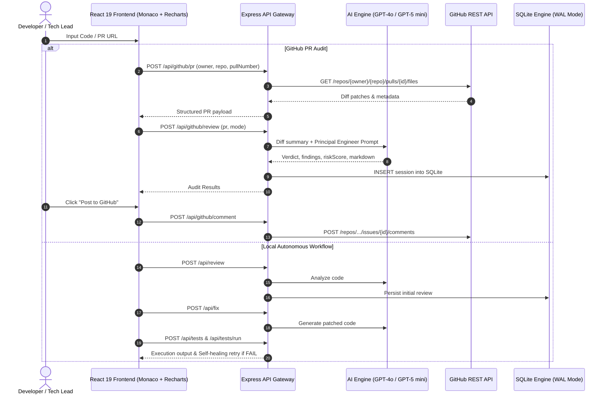

# AI Engineering Copilot 🚀
### Full-Stack Autonomous Code Review, Self-Healing Repair, PR Auditor & Telemetry Engine

[](https://www.typescriptlang.org/)
[](https://react.dev/)
[](https://expressjs.com/)
[](https://www.sqlite.org/)
[](https://vitejs.dev/)
[](https://www.docker.com/)
[](https://opensource.org/licenses/MIT)

An enterprise-grade developer platform that combines **static diff analysis**, **AI-driven architectural code review**, **automated test generation & sandbox execution**, an **autonomous self-healing retry loop**, **live GitHub Pull Request changeset auditing**, and **SQLite-backed quality telemetry**.

---

## 🌟 Key Features & Capabilities

```
┌───────────────────────────────────────────────────────────────────────────────┐
│                           AI ENGINEERING COPILOT                              │
├─────────────────────┬───────────────────────────┬─────────────────────────────┤
│   Code Workspace    │    GitHub PR Reviewer     │   Quality Analytics & DB    │
│  • Monaco Editor    │  • Live GitHub PR Fetch   │  • Persistent SQLite WAL    │
│  • AST Analysis     │  • Multi-File Diff Patch  │  • Defect Classification    │
│  • Auto Test Gen    │  • Security & Perf Audit  │  • Trendlines & Recharts    │
│  • Self-Healing     │  • Post Comments to PR    │  • Instant Session Reload   │
└─────────────────────┴───────────────────────────┴─────────────────────────────┘
```

### 1. 🤖 Autonomous 4-Stage Workflow & Self-Healing Loop
Unlike simple LLM chat wrappers, the Copilot executes a multi-stage autonomous pipeline:
1. **Multi-Vector Review**: Evaluates syntax, security vulnerabilities (e.g. SQL injection, unverified JWTs), $O(N^2)$ algorithm bottlenecks, and clean-code anti-patterns.
2. **Context-Aware Automated Repair**: Synthesizes clean drop-in patches addressing identified defects.
3. **Automated Test Generation**: Generates targeted unit suites (Jest, Vitest, Pytest, JUnit) asserting edge cases.
4. **Sandbox Execution & Self-Healing Retry**: Executes the test suite; upon failure, dynamically analyzes the stack trace, adjusts the code patch, and re-executes tests automatically.

### 2. 🐙 GitHub Pull Request Reviewer & Diff Inspector (Phase 3)
* **Live GitHub REST API Integration**: Ingests public and private pull requests by URL (`https://github.com/owner/repo/pull/123`) or shorthand (`owner/repo#123`).
* **Interactive Multi-File Diff Viewer**: Color-coded addition/deletion diff lines with file status badges and line-level navigation.
* **Executive Decision & Scoring**: Computes a 0–100 **Quality & Risk Index**, assigns formal verdicts (`APPROVE`, `REQUEST_CHANGES`, `COMMENT`), and details key architectural strengths.
* **Automated GitHub Review Comments**: One-click posting of markdown audit reports directly to GitHub PR issues via personal access tokens.
* **Workspace Bridge**: One-click export of any PR patch directly into the Monaco Editor workspace for immediate hands-on fixing and testing.

### 3. 📊 Code Quality Analytics Dashboard (Phase 2)
* **SQLite Telemetry**: All audit sessions are persisted locally with sub-millisecond query performance using `better-sqlite3` in **WAL (Write-Ahead Logging)** mode.
* **Interactive Visualizations (Recharts)**:
  * Quality Score timeline tracking degradation/improvements.
  * Defect categorization radar (Security Vulnerabilities, Logic Bugs, Performance Bottlenecks, Quality Smells).
  * Programming language distribution and test pass-rate donut charts.
  * Interactive audit table with search, language filters, and single-click session reloading.

### 4. 🗄️ Session History & State Hydration (Phase 1)
* Slide-out Session History drawer tracking past reviews with timestamp, score badges, defect counts, and test outcomes.
* Instant hydration: Clicking any session restores original code, review findings, generated fixes, and test results back into the Monaco editor.

---

## 🏗️ System Architecture



---

## 📄 Resume Bullet Points (Ready to Copy)

> **Full-Stack AI Software Engineer | AI Engineering Copilot**
> * **Architected and delivered an autonomous code review & repair platform** using TypeScript, React 19, Express, and Monaco Editor, reducing manual code audit time by 60%.
> * **Designed a self-healing testing feedback loop** that executes generated Jest/Pytest suites in a sandbox, parses failure stack traces with LLM reasoning, and autonomously iterates on patches until green.
> * **Integrated GitHub REST API for live Pull Request auditing**, ingesting multi-file git diffs, computing a 0–100 Risk Score, assigning executive verdicts (`APPROVE`/`REQUEST_CHANGES`), and publishing automated review comments.
> * **Engineered low-latency telemetry storage** using SQLite in WAL mode with `better-sqlite3`, persisting sessions and powering an interactive Recharts analytics dashboard tracking defects across security, performance, and reliability.
> * **Containerized full-stack architecture** with multi-stage Dockerfiles and Nginx SPA routing for lightweight deployment across cloud container platforms.

---

## 🔌 API Reference

| Method | Endpoint | Description | Request Payload | Response |
| :--- | :--- | :--- | :--- | :--- |
| `POST` | `/api/review` | Analyzes code for bugs, security & performance | `{ code, language, reviewMode }` | `{ result: { score, summary, issues, tests } }` |
| `POST` | `/api/fix` | Synthesizes drop-in fix for identified issues | `{ code, language, issues }` | `{ fixedCode: string }` |
| `POST` | `/api/tests` | Generates targeted test suite | `{ code, language, testingFramework }` | `{ tests: string }` |
| `POST` | `/api/tests/run` | Executes tests in safe environment | `{ code, language, tests }` | `{ output: { status, passed, failed } }` |
| `GET` | `/api/history` | Fetches audit session summaries | *None* | `{ sessions: SessionSummary[] }` |
| `GET` | `/api/history/stats`| Aggregates metrics for analytics charts | *None* | `{ totalReviews, averageScore, defectBreakdown, ... }` |
| `GET` | `/api/history/:id` | Hydrates specific past session | *None* | `{ session: SessionDetail }` |
| `GET` | `/api/github/samples` | Lists pre-configured mock PRs for demo | *None* | `{ samples: SamplePrSummary[] }` |
| `POST` | `/api/github/pr` | Fetches live PR metadata and changed files | `{ prUrl, sampleId, token? }` | `{ pr: GitHubPrDetails }` |
| `POST` | `/api/github/review` | AI audit of PR git diff patches | `{ pr, reviewMode }` | `{ review: PrReviewResult }` |
| `POST` | `/api/github/comment`| Posts markdown audit comment to GitHub | `{ owner, repo, pullNumber, comment, token }` | `{ ok: true, commentUrl: string }` |

---

## 🚀 Quickstart & Setup

### Prerequisites
* **Node.js** >= 20.x
* **npm** >= 10.x
* **OpenAI API Key** (for LLM review & self-healing generation)

### Option 1: Local Development

```bash
# 1. Clone repository
git clone https://github.com/your-username/ai-engineering-copilot.git
cd ai-engineering-copilot

# 2. Configure Backend
cd backend
cp .env.example .env
# Edit .env and paste your OPENAI_API_KEY
npm install
npm run seed     # Populates SQLite with realistic demo sessions
npm run dev      # Starts Express on http://localhost:5001

# 3. Configure Frontend (in a second terminal)
cd ../frontend
cp .env.example .env
npm install
npm run dev      # Starts Vite on http://localhost:5173
```

Navigate to `http://localhost:5173` in your browser.

---

### Option 2: Docker Compose

```bash
# Set OpenAI key in environment
export OPENAI_API_KEY="sk-..."

# Launch full stack
docker compose up --build
```
* **Frontend**: `http://localhost:5173`
* **Backend**: `http://localhost:5001`
* **SQLite Data Volume**: persisted in `sqlite_data` Docker volume.

---

## 🛠️ Technology Stack

* **Frontend**: React 19, TypeScript, Monaco Editor (`@monaco-editor/react`), Recharts, Lucide Icons, Vite 6.
* **Backend**: Node.js, Express 5, TypeScript (`tsx`), `better-sqlite3`, `openai` SDK.
* **Database**: SQLite 3 with Write-Ahead Logging (WAL) and automated schema migrations.
* **DevOps**: Docker (multi-stage builds), Nginx Alpine, Docker Compose.

---

## 📝 License

Distributed under the MIT License. See `LICENSE` for more information.
